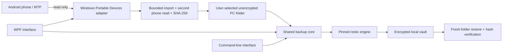

# Current architecture

The USB adapter exposes only list, file metadata and read-stream operations to the importer. Device content is treated as untrusted: local path validation, no-overwrite writes, transfer length limits and checksum checks apply before completing an import. USB and backup have distinct completion states.

The shared backup core owns inventory capture, encrypted snapshot invocation, stored-byte verification, verified-history filtering and safe restore. The vault includes recovery inventory; an old application catalog is not required to restore. Process arguments are passed structurally rather than through a shell. The vault passphrase is not saved in settings or command-line arguments.

## Tradeoffs under evaluation

- The first implementation stages plaintext PC copies. The user chooses the location and is informed they remain. Future encrypted staging/direct streaming needs design and recovery testing.
- Double-reading USB files and re-reading stored originals favors explicit verification, but costs time and I/O. Large-library efficiency is unmeasured.
- A device can change between separate reads. The workflow is not an atomic device snapshot, and imported files can subsequently change on the phone.
- USB cancellation waits for the current Windows transport call. A hung driver needs stronger isolation/timeouts before a consumer reliability claim.
- restic is an evaluated integration, not a frozen choice for every future storage requirement. Cloud and mobile background behavior need separate evidence.

This diagram describes the current developer preview; planned components are not presented as implemented services.
