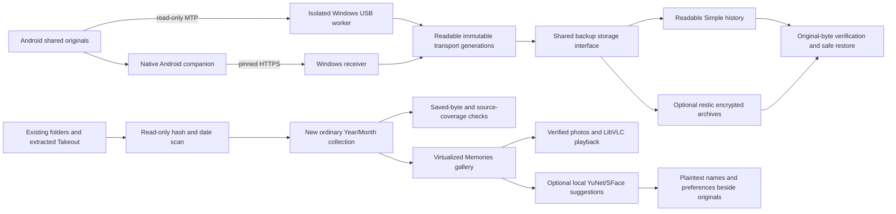

# Architecture — preview 0.8

## Integrity boundaries

Transfers are not complete backups until saved originals are checked. Earlier generations survive source changes/deletion. Restore and collection creation require new/empty destinations; interrupted work keeps checkpoints and refuses damaged existing copies rather than overwriting them. Multi-file backup is not an atomic phone/filesystem snapshot.

The collection scan hashes contents, groups exact duplicates, applies supported embedded dates or labeled filename inference, and preserves unknown dates. Opted-in Takeout metadata uses conservative sidecar matching and records hashes for later consistency checks. Output files receive independent checksum verification; every scanned source occurrence and added path is checked for coverage. Parsed Google metadata introduces plan v2; older apps reject it safely.

## Gallery and people

WPF recycles timeline rows and loads nearby thumbnails with two workers and a bounded memory cache. Full original checks precede new decodes/playback; cached thumbnails remain historical previews. Video handling uses LibVLC and shell file selection handles Unicode paths. Native media isolation and a broad codec corpus remain open work.

People grouping is optional, local and automatic on supported unprocessed photos when a collection opens. A detector, aligned embedding and conservative exemplar comparison produce suggested groups. Manual naming, hiding, merging and correction remain available. A separately locked, atomically replaced plaintext index stores faces/preferences without changing originals. Forgetting removes active face records, not forensic traces. No network identity service is used. Scale and diverse accuracy testing are outstanding.

## Transport and storage tradeoffs

USB repeat verification reads every selected phone file; metadata alone cannot prove content identity. Wi-Fi hashes permitted phone originals and uploads missing/damaged content. Extra readable generations and partials consume disk space; no pruning is automatic. Private vault encryption does not encrypt separate transfer stores or collections.

Android scheduling is best effort under OS quotas. Windows startup, tray operation and protected private unlock require opt-in. Pairing pins the PC certificate and supports revocation; firewall setup is scoped to Private networks/local subnet. PC wake, real Android permissions/Doze/reboot and physical cable reconnection need hardware acceptance. There is no SSID allowlist or cloud relay.

The organized collection and selected backup-version library are separate today. Unifying them must preserve source provenance, immutable recovery history and honest verification status. Commercial release additionally needs dependency/plugin/model provenance, security, signing and installer/update reviews.
