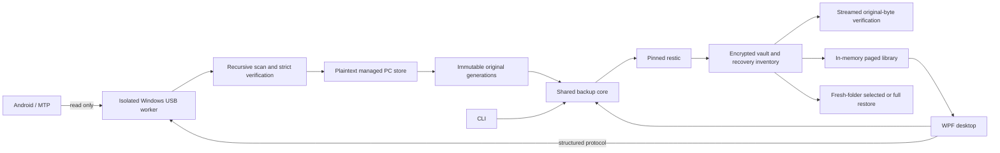

# Current architecture — preview 0.3

## Transport and recovery

The adapter exposes list/stat/read only. A worker process isolates blocking Windows transport calls. The desktop validates structured messages and success/exit state; cancellation and an inactivity deadline stop the owned worker. Progress is tied to actual enumeration/read/local-check activity.

Managed store plans and flushed append journals record completed originals. Repeats/resumes check phone bytes and local hashes, not filename/size/time alone. Earlier generations remain immutable. Torn unfinished journals and unjournaled committed files receive explicit recovery checks. Incomplete runs never become a completed import result.

## Storage and library

The backup core captures inventories inside encrypted snapshots, streams stored originals through strict archive/inventory/length/hash validation and rechecks PC sources before verified tagging. The metadata format remains compatible with prior v1 vaults. Restores require a new/empty destination and verify every restored original; selected export also validates membership in the saved inventory.

The library indexes the selected verified snapshot in memory. Search, folder albums, modified dates, categories and checksum duplicates are metadata operations. Bounded thumbnail pages decode verified originals into detached display pixels, without persistent plaintext thumbnails/catalog. Media decoding and temporary inventory/secret handling still need production hardening.

## Tradeoffs

- Plaintext staging is explicitly retained; encrypted direct streaming/staging is future work.
- New generations use local copies rather than hardlinks, preserving independence but consuming disk space.
- Repeat USB verification still reads all selected phone bytes once. Companion-side hashes can improve that later.
- Multi-file phone state is not an atomic snapshot. A physical cable-pull test is separate from killing a worker.
- restic is an evaluated storage integration, not a guarantee for every future cloud/mobile requirement.
