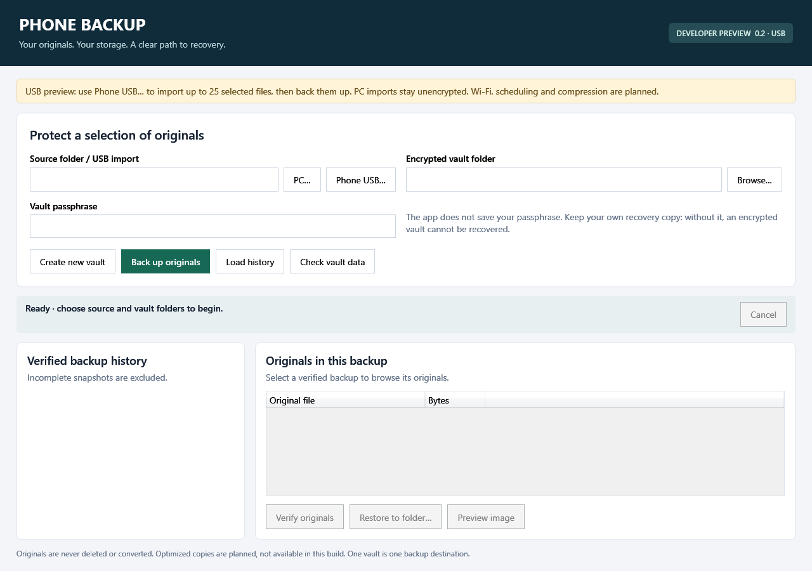

# Phone Backup

A Windows-first Android backup product in development: preserve original photos, videos and selected files on your own PC, with a clear way to verify and restore them.

**Status: developer preview, not a consumer release.** Product implementation is private. This public showcase explains the architecture, engineering work and measured progress without distributing personal media or proprietary source.

## What works today

- Native Windows desktop UI built with C#/.NET 10 and WPF, with a shared core and CLI.
- Selected-file Android USB import through Windows Portable Devices: browse storage, select up to 25 files / 512 MiB, and import into an empty PC folder.
- Independent second read from the phone and SHA-256 verification of the PC copy before completing import.
- Encrypted backup using a pinned restic engine, verified history, original version retention and checksum-verified restore into an empty folder.
- A real Pixel 7 → USB import → encrypted backup → restore test passed for one existing original on 28 October 2026. This is a narrow hardware proof, not broad device certification.

## Verification evidence

| Check | Result | Scope |
|---|---|---|
| Core integration checks | 19 passed | Generated local data, encrypted snapshots, restore, cancellation, unsafe metadata, corruption detection |
| USB adapter checks | 10 passed | Fake source: exact bytes, repeated reads, mutation, truncation, limits, cancellation and safe destinations |
| Real Pixel 7 sample | Passed | One original read twice over USB, PC copy verified, encrypted and restored with matching checksum |
| Interactive usability and physical unplug recovery | Pending | Not established by offscreen UI rendering or simulated disconnects |

No personal filenames, phone serial numbers, media or source-library inventories are published here. The screenshot uses an empty app state.

## Engineering decisions

The first USB workflow deliberately separates import from encryption: selected phone files become ordinary unencrypted PC copies, then the user backs that folder up to an encrypted vault. The UI discloses that retained staging data. This keeps the first transport integration inspectable while direct streaming/encrypted staging remains an open design question.

A backup appears as verified only after stored original bytes match their captured SHA-256 inventory and the PC selection is rechecked. Restore creates fresh files, refuses nonempty destinations, and verifies restored bytes. Previous snapshots survive source edits and deletions. These checks reduce common failure risks; they do not constitute an independent security audit or atomic phone snapshot.

See [architecture](ARCHITECTURE.md) and [development record](DEVELOPMENT.md) for the current boundaries.

## Next milestones

1. Interactive USB acceptance, real disconnect/reconnect recovery, and larger selections.
2. Whole-folder selection and incremental phone inventory with stable device identity.
3. Android companion app with authenticated local Wi-Fi transfers.
4. Reliable recurring backups, then a photo timeline and library browsing.
5. Optional optimized viewing copies alongside preserved originals.
6. Release hardening, signed distribution, dependency review and external beta testing.

Cloud destinations, household features and iPhone support are future scope. There is no download or release date promised by this showcase.

## Technology and attribution

C#, .NET 10, WPF, Windows Portable Devices via the community [MediaDevices library](https://github.com/Bassman2/MediaDevices), and [restic](https://github.com/restic/restic) for evaluated encrypted storage. These are independent upstream projects; this product does not claim their implementation as original work. AI-assisted development uses shared change logs and human-directed review. License/security review remains a release gate.
