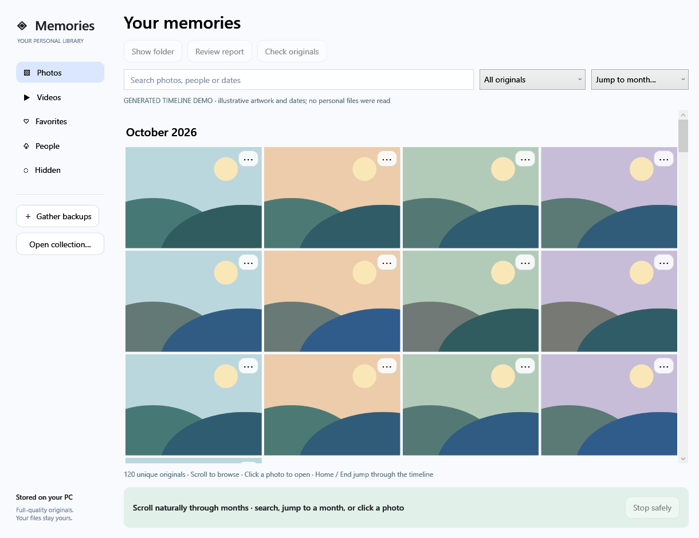

# Phone Backup

A Windows-first Android backup product in development: keep original photos, videos and selected files on your PC, verify saved bytes, and recover them into ordinary folders.

**Version 0.8 developer preview.** Product source is private. This public repository contains engineering explanations and synthetic interface screenshots, not personal media or downloadable product binaries.

The native interface above is rendered from the application using explicitly labeled synthetic artwork. It demonstrates the layout, not a real user's library or face-recognition accuracy.

## What changed

- Gather multiple old backup folders into a new Year/Month collection. Exact full-checksum duplicates share one copy; edited/compressed variants remain separate. Originals stay readable in Explorer, and old folders are untouched.
- Browse a continuous month timeline with search, month navigation, Videos, Favorites, People and Hidden views. Folder addition immediately starts a scan with visible file/byte progress and cancellation.
- Play collection videos with LibVLC, including pause, seek and volume. Checksummed video posters are bounded; full original verification precedes playback. Shell item selection handles Unicode filenames.
- Optionally enable automatic local face grouping using pinned OpenCV YuNet/SFace models. Name, merge or correct suggested groups, hide a person from browsing, and forget face data. Names, face vectors and preferences are stored locally in plaintext; hiding is not file encryption. No cloud recognition or identity lookup.
- Import extracted Google Takeout parts with conservative capture-date/sidecar matching. Combine a completed collection with new folders into a fresh destination. Ambiguous metadata is reported; no direct Google account sync or in-place append is claimed.

## Backup foundations

Simple backup starts with one recommended location and readable, verified recovery history. Private encrypted archives remain optional. The Windows app includes read-only USB imports with a separate worker, resumable file checkpoints, verified repeat reuse, and safe full/selected restore.

A native Android companion and Windows receiver implement one-use QR pairing, certificate-pinned HTTPS, missing-content uploads, device revocation and opt-in background setup. Physical Pixel 7 / Android 17 background, permission and battery acceptance remains unfinished; the PC must be awake. The organized collection gallery and backup-version library are currently separate workflows.

## Evidence and limits

The latest organizer suite passes 53 generated-data scenarios covering exact duplicates, source preservation, interruption/resume, date extraction, Takeout conflicts/changes, metadata size limits and people-index behavior. Regression runs pass 24 private-core, 21 Simple-storage, 24 USB, 24 private-LAN and 25 Simple-LAN scenarios. Packaged UI/media checks cover timeline virtualization, names/hiding/favorites, native inference on a public test portrait, Unicode video decoding, pause/seek, and the existing backup library.

These are engineering fixtures, not production certification. Face-group accuracy across diverse real libraries, broad codec/HDR coverage, large-library performance, decoder isolation, disk-full/power-loss behavior, signed distribution, commercial dependency/model clearance and physical automatic phone backup remain release gates. HEIC/RAW face analysis, cloud storage, saved compression variants and iPhone support are not implemented. The native codec bundle's individual licensing obligations and model training provenance still require review before commercial distribution.

Originals are never automatically deleted. A verified copy establishes byte agreement with the supplied source, not visual health, correct camera clocks or recovery of files missing from every supplied folder. Users review reports and their collection before making any independent cleanup decision.

## Engineering notes

- [Architecture and tradeoffs](ARCHITECTURE.md)
- [Dated development record](DEVELOPMENT.md)

The project uses C#/.NET/WPF, native Android/Java, Windows device APIs, SHA-256 verification, restic for optional private archives, LibVLC and OpenCV. Maintained libraries provide media/backup engines; product workflows, verification and compatibility rules are tested separately. AI-assisted development is documented with actual validation and open gates. Commits reflect real completed work; no contribution history is fabricated or backdated.
